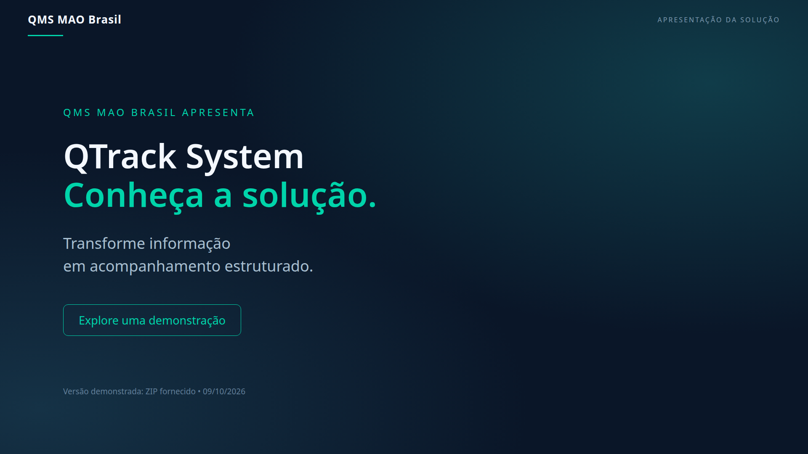

# Apresentação em vídeo — QMS MAO Brasil

**QMS MAO Brasil** apresenta o **QTrack System**, com demonstração real de telas e navegação da versão fornecida no arquivo `qms-mao-brasil_versão09102026.zip`.

## Assistir ou baixar

**[Abrir o vídeo com áudio](https://files.manuscdn.com/user_upload_by_module/session_file/310419663029478970/QssSEEuNdliWmbkc.mp4)**

O MP4 está hospedado externamente e referenciado nesta documentação: **o binário não está versionado no Git**. A sincronização gerenciada do projeto não aceita mídia acima de 1 MB. A capa, as legendas e os metadados estão versionados em `docs/videos/`.

Ative o alto-falante do player. Para baixar, use a opção de download do navegador/player ou salve o link; se a prévia não reproduzir o áudio, abra o arquivo baixado no VLC ou no player do computador/celular.

| Propriedade | Valor |
| --- | --- |
| Duração | 75 segundos |
| Imagem | Full HD — 1920 × 1080, 16:9, 30 fps |
| Contêiner / vídeo | MP4 / H.264, yuv420p |
| Áudio | AAC-LC, estéreo, 44,1 kHz, marcado como faixa padrão |
| Idioma | Narração em português brasileiro |
| Legendas | Incorporadas no vídeo e [SRT separado](legendas-pt-BR.srt) |
| Trilha | Instrumental original, abaixo da narração |
| Produção | 09/10/2026 |
| Metadados | [video.json](video.json) |

## Conteúdo

| Tempo | Demonstração |
| --- | --- |
| 00:00–00:07 | Desafio de acompanhamento da qualidade |
| 00:07–00:17 | Dashboard: status, aging e prioridades |
| 00:17–00:27 | Filtro por fornecedor e consulta de um defeito |
| 00:27–00:38 | 8D, área de evidências e auditoria |
| 00:38–00:46 | Kanban por etapa |
| 00:46–00:54 | Importação e opções de relatórios |
| 00:54–01:04 | AI Control Center e guardrails |
| 01:04–01:15 | Proposta de valor e convite para conhecer a solução |

## Fidelidade e privacidade

A interface foi executada a partir do código do ZIP, em cópia isolada. Como o ZIP não inclui um banco completo, as telas consultaram a base demonstrativa vinculada ao projeto. O vídeo não é uma captura da versão mais recente do código desta branch.

Dados pessoais de perfil foram ocultados. Nenhuma credencial ou código de acesso foi incluído. Não foram simulados uploads, exportações concluídas, decisões de IA, integrações operacionais ou melhorias de desempenho. As telas e estados vazios refletem o ambiente observado na gravação.

O arquivo hospedado é a **exportação com áudio compatível**, revisada após a primeira entrega. Esta alteração é apenas de documentação; não muda o frontend, o backend ou o banco da aplicação.

[Voltar ao README principal](../../README.md)
